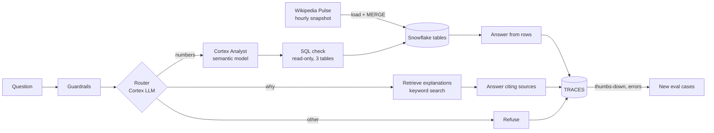

# Ask Pulse on Snowflake 📈

**Ask what India is reading on Wikipedia, in plain English, and get answers you can trust.**
A Snowflake agent built with **Cortex Analyst** (text-to-SQL on a semantic model) and **keyword retrieval with cited answers** (Cortex Search optional)
(retrieval over AI explanations), with SQL guardrails, refusals and a **golden-set evaluation that every
version is measured against**.

**Eval report:** https://lokesh4561.github.io/ask-pulse-snowflake/ · Data: the live
[Wikipedia Pulse](https://github.com/Lokesh4561/wikipedia-pulse) lakehouse (English + 13 Indian languages, hourly).



## Measuring quality

`evals/golden.yaml` holds the questions; `evals/run.py` runs them and `evals/report.py` builds the report.

| Question type | How it is scored |
|---|---|
| **Data** (30) | The agent's SQL result must match a reference SQL query run on the same data at the same time (order-aware for rankings, extra columns allowed, numeric tolerance) |
| **Why** (12, generated) | Built at run time from real trending pages that have an explanation, in 3 phrasings. Scored on retrieval (right page in the top 5) and faithfulness (LLM judge checks every claim against the sources) |
| **Out of scope** (4) | Must refuse and run no SQL: write requests, prompt injection, off-topic |
| **Unanswerable** (3) | Data that doesn't exist (mobile share, editors, 2019): must say so, never invent a number |

Every failure gets a **failure mode**: `route_error`, `no_sql`, `blocked_sql`, `sql_error`, `empty_result`,
`wrong_result`, `retrieval_miss`, `said_not_found`, `unfaithful`, `answered_out_of_scope`, `made_up_answer`.

**The hill-climb.** The semantic model has three versions (`askpulse/semantic.py`), each scored on the same set:

| Version | Change | Targets |
|---|---|---|
| v1 | tables and columns only | baseline |
| v2 | descriptions, business rules ("last 24 hours" is relative to the newest loaded hour; "trending now" = 6 hours), language-code synonyms (te = Telugu) | `wrong_result` from time windows and language names |
| v3 | verified queries (worked examples) | remaining `wrong_result` on rankings and time series |

**Closing the loop.** The app logs every question to `TRACES` with a 👍/👎. `python -m evals.mine` exports
thumbs-down, errors and blocked queries as candidates for the golden set.

## Guardrails
- Input: prompt-injection and secret requests, write/admin requests and off-topic questions are refused.
- SQL: only one read-only `SELECT`/`WITH` statement on the three data tables may run, wrapped in `LIMIT 200`,
  with a 60 s statement timeout and a least-privilege role.
- Answers: numbers come only from the returned rows; "why" answers must cite retrieved sources or say they don't know.

## Setup (about 30 minutes, free trial is enough)

1. **Snowflake trial** at signup.snowflake.com (any cloud, Enterprise edition).
2. **Key-pair login** for the service user (on your laptop):
   ```bash
   openssl genrsa 2048 | openssl pkcs8 -topk8 -inform PEM -out rsa_key.p8 -nocrypt
   openssl rsa -in rsa_key.p8 -pubout -out rsa_key.pub
   ```
   Copy the body of `rsa_key.pub` (without the BEGIN/END lines, on one line) into `sql/setup.sql` as `<PUBLIC_KEY>`.
3. **Run `sql/setup.sql`** in a Snowsight worksheet.
4. **GitHub secrets:** `SNOWFLAKE_ACCOUNT` (e.g. `abc12345.ap-south-1.aws`, from Snowsight → account → "Copy account
   identifier", use the `orgname-accountname` form) and `SNOWFLAKE_PRIVATE_KEY` (the whole `rsa_key.p8` text).
5. **Actions → load → Run workflow.** It then runs every hour, and history builds up from today.
6. After a day or two of data: **Actions → evaluate → Run workflow** (`v1 v2 v3`). Results land in
   `evals/RESULTS.md` and the report page (Settings → Pages → `main` / `/docs`).
7. **App:** `streamlit run app/streamlit_app.py` with the same two variables set.

Cost: an XSMALL warehouse that suspends after 60 s, plus Cortex calls; a full eval run uses a small part of
the trial credits.

## Limitations
- The golden set is small (~50 questions) and written by me; scores are a development benchmark, not a held-out test.
- Some "why" pages are retrieved by title words only; pages with non-Latin titles are harder to find.
- The LLM judge can be wrong; its verdicts are kept in the results for spot checks.
